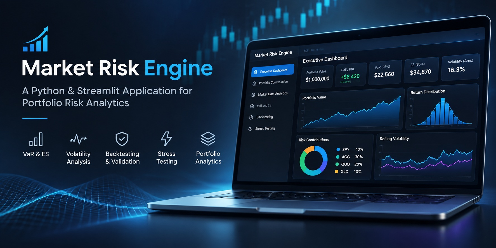

<p align="center">
  
</p>


# Equity Portfolio Market Risk Engine

A Python-based market risk analytics application for constructing and
monitoring **equity portfolios made up of selected stocks**. Built with
Streamlit, it combines portfolio construction, market data analytics,
Value at Risk (VaR), Expected Shortfall, backtesting, stress testing and
drawdown analysis.

> **Project scope:** This application currently focuses on portfolios of
> selected listed equities. It is not a universal multi-asset risk
> platform. Users select stocks from a locally maintained universe,
> assign weights and analyze the resulting equity portfolio.

## Table of Contents

-   [Overview](#overview)
-   [Typical Workflow](#typical-workflow)
-   [Application Workflow](#application-workflow)
-   [Detailed Page Guide](#detailed-page-guide)
-   [Risk Methodologies](#risk-methodologies)
-   [Technology Stack](#technology-stack)
-   [Project Structure](#project-structure)
-   [Installation](#installation)
-   [Run the Application](#run-the-application)
-   [Assumptions and Limitations](#assumptions-and-limitations)
-   [Disclaimer](#disclaimer)

## Overview

The Equity Portfolio Market Risk Engine lets users build a portfolio of selected stocks, track its performance and understand the risks involved.

Users can select stocks, assign weights, set the investment period and starting amount, and choose a rebalancing strategy. The application downloads and validates daily stock prices, calculates portfolio returns and value, and uses this data to analyze volatility, measure risk through VaR and Expected Shortfall, backtest risk estimates, run stress scenarios and monitor performance through the dashboard.

## Typical Workflow

```mermaid
flowchart LR
    A["1. Portfolio Construction<br/><br/>Select stocks, assign weights,<br/>investment period and capital"]

    B["2. Market Data Analytics<br/><br/>Returns, volatility, correlations<br/>and distributions"]

    C["3. VaR and ES<br/><br/>Historical, Parametric and<br/>Monte Carlo VaR and ES"]

    D["4. Backtesting<br/><br/>VaR exceptions, Kupiec POF<br/>and Christoffersen tests"]

    E["5. Stress Testing<br/><br/>Historical shocks, custom<br/>scenarios and attribution"]

    F["6. Executive Dashboard<br/><br/>Portfolio performance, P&L,<br/>VaR and drawdown"]

    A --> B --> C --> D --> E --> F

    classDef setup fill:#1E3A5F,stroke:#4A90D9,color:#FFFFFF
    classDef analytics fill:#164E45,stroke:#42B89C,color:#FFFFFF
    classDef measurement fill:#67421D,stroke:#E5A443,color:#FFFFFF
    classDef validation fill:#632B35,stroke:#D96B78,color:#FFFFFF
    classDef stress fill:#59451C,stroke:#D6B34A,color:#FFFFFF
    classDef monitoring fill:#44315F,stroke:#A58AD4,color:#FFFFFF

    class A setup
    class B analytics
    class C measurement
    class D validation
    class E stress
    class F monitoring
```


## Application Pages

| Page | Description | Source |
|---|---|---|
| Executive Dashboard | Portfolio performance and risk overview | [View](pages/0_Executive_Dashboard.py) |
| Portfolio Construction | Stock selection, weights and rebalancing | [View](pages/1_Portfolio_Construction.py) |
| Market Data Analytics | Returns, volatility and correlation analysis | [View](pages/2_Market_Data_Analytics.py) |
| VaR and ES | Portfolio downside risk estimation | [View](pages/3_VaR_and_ES.py) |
| Backtesting | VaR forecast validation | [View](pages/4_Backtesting.py) |
| Stress Testing | Historical and custom stress scenarios | [View](pages/5_Stress_Testing.py) |

## Risk Methodologies


| Measure | Method | Purpose |
|---|---|---|
| Portfolio Returns | Weighted portfolio returns | Measure portfolio performance |
| Drawdown | Decline from running peak | Measure peak-to-trough losses |


| Measure | Method | Purpose |
|---|---|---|
| Rolling Volatility | Rolling standard deviation | Measure recent realized variability |
| EWMA Volatility | Exponentially weighted moving average | Weight recent observations more heavily |
| GARCH Volatility | GARCH(1,1) | Estimate conditional volatility |


| Measure | Method | Purpose |
|---|---|---|
| Historical VaR | Empirical return distribution | Estimate a historical quantile loss threshold |
| Parametric VaR | Normal distribution | Estimate a model-based loss threshold |
| Monte Carlo VaR | Multivariate normal simulation | Estimate a simulated loss threshold |
| Expected Shortfall | Average loss beyond VaR | Measure tail-loss severity |


| Measure | Method | Purpose |
|---|---|---|
| VaR Backtesting | Kupiec POF test | Evaluate whether the observed exception rate is consistent with the expected rate |
| VaR Backtesting | Christoffersen tests | Evaluate exception independence and conditional coverage |


| Measure | Method | Purpose |
|---|---|---|
| Historical Stress | Historical stock returns and shocks | Assess portfolio sensitivity to historical market events |
| Custom Scenarios | User-defined stock shocks | Evaluate hypothetical adverse scenarios |
| Stress Attribution | Stock-level P&L contributions | Identify the contribution of individual stocks to portfolio stress losses |

## Technology Stack

-   Python
-   Streamlit
-   Pandas
-   NumPy
-   Plotly
-   SciPy
-   yfinance
-   ARCH

## Project Structure

The following is the intended high-level structure. Adjust filenames if
the repository uses different names.

``` text
market-risk-engine/
├── app.py
├── requirements.txt
├── data/
│   └── stock_universe.csv
├── pages/
│   ├── 0_Executive_Dashboard.py
│   ├── 1_Portfolio_Construction.py
│   ├── 2_Market_Data_Analytics.py
│   ├── 3_VaR_and_ES.py
│   ├── 4_Backtesting.py
│   └── 5_Stress_Testing.py
├── src/
    ├── market_data.py
    ├── market_data_analytics.py
    ├── portfolio_construction.py
    ├── value_at_risk.py
    ├── backtesting.py
    ├── drawdown.py
    └── stress_testing.py

```

`app.py` initializes shared session state and defines the six-page
navigation. `pages/` contains the Streamlit user interface. `src/`
contains reusable market-data, portfolio and risk calculations.
`data/stock_universe.csv` provides the available stock tickers.

## Installation

### 1. Clone the repository

``` bash
git clone https://github.com/VineedMindForge/RiskForge.git
cd RiskForge
```

### 2. Create and activate a virtual environment

**Windows**

``` bash
python -m venv .venv
.venv\Scripts\activate
```

**macOS / Linux**

``` bash
python -m venv .venv
source .venv/bin/activate
```

### 3. Install dependencies

``` bash
pip install -r requirements.txt
```

### 4. Check the stock universe

Ensure `data/stock_universe.csv` exists and contains a column named
`ticker`. Add the ticker symbols you want users to be able to select.

## Run the Application

From the project root:

``` bash
streamlit run app.py
```

Open the local URL printed in the terminal (normally
`http://localhost:8501`) and use the sidebar to navigate between the six
pages.

## Assumptions and Limitations

1.  **Equity-only scope:** The current application analyzes selected
    stocks. It does not currently model bonds, currencies, commodities,
    options or other asset classes.
2.  **Market data source:** Adjusted daily closing prices are retrieved
    through `yfinance`; availability and quality depend on the provider.
3.  **Annualization:** Volatility calculations use 252 trading days per
    year.
4.  **Long-only weights:** Portfolio weights must be non-negative and
    sum to 100%.
5.  **Rebalancing:** Buy and Hold, Daily and Monthly rebalancing produce
    different portfolio returns and risk results.
6.  **Missing data:** Missing prices are not automatically interpolated
    or forward-filled. Portfolio calculations use observations that
    satisfy the relevant data requirements.
7.  **Historical VaR:** Results depend on the selected historical sample
    and cannot capture losses outside the observed sample.
8.  **Parametric VaR:** The normal-distribution assumption may not
    represent fat tails or other non-normal characteristics of equity
    returns.
9.  **Monte Carlo VaR:** The current simulation uses multivariate normal
    asset returns estimated from historical means and covariance. It
    does not represent every possible source of market risk.
10. **Stress tests:** Scenario results are conditional calculations, not
    forecasts or probability estimates.
11. **Risk limits:** Any user-configured thresholds are illustrative
    unless calibrated and approved for a defined investment mandate.

## Limitations and Future Enhancements

Potential extensions include fat-tailed Monte Carlo distributions,
alternative covariance and volatility forecasts, more advanced
historical simulation using current holdings and stock-level shocks,
transaction costs and turnover, additional portfolio constraints,
expanded asset-class support, more comprehensive risk-limit
configuration and automated reporting.

These are possible future enhancements, not claims about the current
implementation.

## Disclaimer

This project is developed for educational, analytical and portfolio risk
modelling purposes. It is not investment advice and should not be
treated as a production risk management system.

External market data may be incomplete, delayed, revised or unavailable.
VaR, Expected Shortfall, volatility estimates, backtesting results and
stress scenarios are model outputs based on assumptions and historical
observations. They do not guarantee future performance or define the
maximum possible loss.
