# Equity Portfolio Market Risk Engine

A Python-based market risk analytics application for constructing and
monitoring **equity portfolios made up of selected stocks**. Built with
Streamlit, it combines portfolio construction, market data analytics,
Value at Risk (VaR), Expected Shortfall, backtesting, stress testing and
drawdown analysis.

> **Project scope:** This application currently focuses on portfolios of
> selected listed equities. It is not a universal multi-asset risk
> platform. Users select stocks from a locally maintained universe,
> assign weights and analyze the resulting equity portfolio.

## Table of Contents

-   [Overview](#overview)
-   [Features](#features)
-   [Application Workflow](#application-workflow)
-   [Detailed Page Guide](#detailed-page-guide)
-   [Risk Methodologies](#risk-methodologies)
-   [Technology Stack](#technology-stack)
-   [Project Structure](#project-structure)
-   [Installation](#installation)
-   [Run the Application](#run-the-application)
-   [Assumptions and Limitations](#assumptions-and-limitations)
-   [Disclaimer](#disclaimer)

## Overview

The Equity Portfolio Market Risk Engine demonstrates an end-to-end
workflow for constructing, analyzing and monitoring a portfolio of
selected stocks.

The user selects equities from a CSV-based stock universe, assigns
portfolio weights, specifies an investment period and initial
investment, and chooses a rebalancing methodology. The application
downloads adjusted daily closing prices, validates the data and
calculates portfolio returns and value. Those portfolio results are then
used across the analytics, VaR, backtesting, stress-testing and
dashboard pages.

## Typical Workflow

```mermaid
flowchart LR
    A["1. PORTFOLIO SETUP<br/><br/>Portfolio Construction<br/>Select stocks, assign weights,<br/>investment period and capital"]

    B["2. MARKET ANALYSIS<br/><br/>Market Data Analytics<br/>Returns, volatility, correlations<br/>and distributions"]

    C["3. RISK MEASUREMENT<br/><br/>VaR and ES<br/>Historical, Parametric and<br/>Monte Carlo VaR and ES"]

    D["4. MODEL VALIDATION<br/><br/>Backtesting<br/>VaR exceptions, Kupiec POF<br/>and Christoffersen tests"]

    E["5. STRESS ANALYSIS<br/><br/>Stress Testing<br/>Historical shocks, custom<br/>scenarios and attribution"]

    F["6. RISK MONITORING<br/><br/>Executive Dashboard<br/>Portfolio performance, P&L,<br/>VaR and drawdown"]

    A --> B --> C --> D --> E --> F

    classDef setup fill:#1E3A5F,stroke:#4A90D9,color:#FFFFFF
    classDef analytics fill:#164E45,stroke:#42B89C,color:#FFFFFF
    classDef measurement fill:#67421D,stroke:#E5A443,color:#FFFFFF
    classDef validation fill:#632B35,stroke:#D96B78,color:#FFFFFF
    classDef stress fill:#59451C,stroke:#D6B34A,color:#FFFFFF
    classDef monitoring fill:#44315F,stroke:#A58AD4,color:#FFFFFF

    class A setup
    class B analytics
    class C measurement
    class D validation
    class E stress
    class F monitoring
```



## Features

-   Equity portfolio construction using a configurable local ticker
    universe.
-   Long-only portfolio weights and configurable initial investment.
-   Buy and Hold, Daily and Monthly rebalancing.
-   Daily adjusted-price download and data-quality reporting.
-   Asset return statistics, rolling volatility, EWMA and GARCH
    volatility.
-   Correlation matrices and rolling correlation analysis.
-   Return distribution visualization and Jarque--Bera normality
    testing.
-   Historical Simulation, Parametric and Monte Carlo VaR and Expected
    Shortfall.
-   VaR backtesting, including Kupiec and Christoffersen tests.
-   Historical worst-case scenarios and custom stock-level shocks.
-   Portfolio drawdown and recovery analysis.
-   Consolidated Executive Dashboard.

## Application Workflow

The application is organized as six pages, with `app.py` acting as the
entry point and navigation controller.

### 1. Executive Dashboard

The dashboard is the consolidated portfolio monitoring view.

**Portfolio Overview** - **Portfolio Value:** Latest calculated
portfolio value. - **Daily P&L:** Change in portfolio value between the
latest two observations. - **Total Return:** Cumulative portfolio return
over the investment period. - **CAGR:** Annualized compound growth
rate. - **Annualized Volatility:** Standard deviation of daily portfolio
returns annualized using 252 trading days. - **Sharpe Ratio:**
Risk-adjusted return measure using the risk-free-rate assumption in the
portfolio metrics calculation. - **Initial Investment:** Starting
capital used to construct the portfolio.

**Portfolio Performance:** A time series of portfolio value over the
selected investment period.

**Risk Snapshot** - **Historical VaR:** One-day Historical Simulation
VaR at the configured confidence level and lookback. - **Latest Daily
Return:** Most recent portfolio return observation. - **Current
Drawdown:** Current value relative to the running peak. - **Maximum
Drawdown:** Largest peak-to-trough decline in the available portfolio
history. - **Recovery Status:** Whether the portfolio has recovered to
the peak associated with its maximum drawdown.

**Portfolio Drawdown:** Shows the percentage decline from the running
portfolio peak through time.

**Daily Loss vs Historical VaR:** Compares the latest realized daily
loss with the Historical Simulation VaR threshold. This is a simple
latest-observation comparison, not a replacement for formal VaR
backtesting.

### 2. Portfolio Construction

This page defines the equity portfolio used by the rest of the
application.

**Stock universe and selection:** Available tickers are loaded from
`data/stock_universe.csv`. The universe is maintained locally; it is not
dynamically downloaded.

**Weights:** Users assign a weight to each selected stock. The current
portfolio construction logic is long-only: weights must be non-negative
and sum to 100%.

**Investment settings:** Users set the investment start and end dates,
initial investment amount and rebalancing frequency.

**Rebalancing methods** - **Buy and Hold:** Initial weights are allowed
to drift as stock prices change. - **Daily:** The portfolio is
rebalanced to target weights each trading day. - **Monthly:** The
portfolio is rebalanced to target weights at monthly rebalancing points.

These methods produce different portfolio return paths and therefore
different downstream risk estimates.

**Market data and quality checks:** Adjusted daily closing prices are
downloaded through `yfinance`. The market data module supports up to ten
years of history by default. Each ticker is returned with the history
available for it.

The data-quality report includes valid observation counts, missing
observations and percentages, invalid prices, duplicate dates, first and
last available dates, latest valid price and latest valid price date.
Leading missing observations before a stock's first available price are
treated as expected history gaps. Missing prices are not automatically
interpolated or forward-filled.

### 3. Market Data Analytics

This page focuses on the historical behaviour of the selected stocks.

**Daily returns**

Simple daily returns are calculated from adjusted closing prices:

$$r_t = \frac{P_t}{P_{t-1}} - 1$$

where $P_t$ is the adjusted closing price at time $t$.

Descriptive statistics include mean return, annualized return, daily and
annualized volatility, skewness, excess kurtosis, best daily return and
worst daily return.

**Volatility** - **Rolling volatility:** Rolling standard deviation of
returns, annualized using 252 trading days. - **EWMA volatility:**
Exponentially weighted volatility based on squared daily returns. The
analytics function uses a decay factor of 0.94 by default. -
**GARCH(1,1):** Conditional volatility estimated with a GARCH(1,1)
model, zero-mean specification and normally distributed innovations.

**Correlation:** The page calculates correlations between selected-stock
daily returns. Correlations can be examined over the full available
history or a recent lookback window. Rolling correlation can be used to
examine the changing relationship between two stocks.

**Return distribution and normality:** Histograms and normal reference
curves help compare observed returns with a normal distribution. The
page also calculates skewness, excess kurtosis and the Jarque--Bera
normality test.

### 4. VaR and Expected Shortfall

This page estimates portfolio downside risk using three approaches.

**Value at Risk (VaR)** is a loss threshold for a specified confidence
level and holding period. A one-day 95% VaR estimates a threshold that
losses are expected to exceed in approximately 5% of observations under
the model assumptions. VaR is not the maximum possible loss.

**Historical Simulation** 1. Select the historical portfolio-return
window. 2. Compound returns over the chosen holding period. 3. Find the
lower-tail empirical return quantile corresponding to the confidence
level. 4. Convert the negative return threshold into a VaR amount. 5.
Calculate Expected Shortfall as the average loss among observations at
or beyond the VaR threshold.

**Parametric method:** Uses the sample mean and standard deviation of
portfolio returns with a normal-distribution quantile to estimate VaR
and Expected Shortfall. The results depend on the normality assumption.

**Monte Carlo method:** Simulates correlated stock returns using a
multivariate normal distribution estimated from historical asset-return
means and covariance. Simulated asset returns are combined using
portfolio weights to obtain simulated portfolio returns. The current
implementation applies target weights each simulated day and uses a
fixed random seed by default for reproducibility.

**Comparison and sensitivity:** The page compares VaR and Expected
Shortfall across Historical, Parametric and Monte Carlo methods and
supports sensitivity analysis across confidence levels and holding
periods.

### 5. Backtesting

Backtesting evaluates VaR forecasts against subsequently realized
portfolio returns. A VaR exception occurs when the realized portfolio
loss exceeds the VaR forecast for that observation.

The application supports Historical, Parametric, EWMA and GARCH VaR
forecasts and reports exception counts and rates.

-   **Kupiec Proportion of Failures (POF):** Tests whether the observed
    exception frequency is consistent with the expected exception
    probability.
-   **Christoffersen independence test:** Examines whether exceptions
    occur independently or cluster over time.
-   **Conditional coverage test:** Combines exception-frequency and
    independence components.

Backtesting evaluates how the VaR model performs against realized
outcomes; it is distinct from simply displaying a VaR estimate.

### 6. Stress Testing

Stress testing examines the impact of severe historical conditions and
user-defined stock-price shocks.

**Worst historical portfolio scenarios:** Identifies the worst
compounded portfolio-return windows for configurable horizons, including
one-, five- and twenty-day periods. Results include dates, stress
return, stress P&L and stressed portfolio value.

**Historical stock scenarios:** Identifies severe historical
stock-return windows and applies the resulting stock-level shocks to the
current target weights. This helps examine how the current portfolio
composition would have behaved under selected historical stock shocks.

**Custom scenarios:** Users define named scenarios by assigning
percentage shocks to selected stocks. Unspecified stocks receive a zero
shock.

For portfolio weights ($w_i$) and stock shocks ($s_i$):

$$
R_{\text{stress}} = \sum_i w_i s_i
$$

$$
\text{Stress P\&L} = V_0 \times R_{\text{stress}}
$$

$$
V_{\text{stressed}} = V_0 + \text{Stress P\&L}
$$

where $V_0$ is the portfolio value used in the scenario calculation.

**Stress attribution:** Stock-level P&L contributions show how
individual positions contribute to the total stress outcome. Historical
stress attribution uses asset returns and allocation drift over the
selected period to reconcile asset contributions with portfolio returns.

## Risk Methodologies


| Measure | Method | Purpose |
|---|---|---|
| Portfolio Returns | Weighted portfolio returns | Measure portfolio performance |
| Drawdown | Decline from running peak | Measure peak-to-trough losses |


| Measure | Method | Purpose |
|---|---|---|
| Rolling Volatility | Rolling standard deviation | Measure recent realized variability |
| EWMA Volatility | Exponentially weighted moving average | Weight recent observations more heavily |
| GARCH Volatility | GARCH(1,1) | Estimate conditional volatility |


| Measure | Method | Purpose |
|---|---|---|
| Historical VaR | Empirical return distribution | Estimate a historical quantile loss threshold |
| Parametric VaR | Normal distribution | Estimate a model-based loss threshold |
| Monte Carlo VaR | Multivariate normal simulation | Estimate a simulated loss threshold |
| Expected Shortfall | Average loss beyond VaR | Measure tail-loss severity |


| Measure | Method | Purpose |
|---|---|---|
| VaR Backtesting | Kupiec POF test | Evaluate whether the observed exception rate is consistent with the expected rate |
| VaR Backtesting | Christoffersen tests | Evaluate exception independence and conditional coverage |


| Measure | Method | Purpose |
|---|---|---|
| Historical Stress | Historical stock returns and shocks | Assess portfolio sensitivity to historical market events |
| Custom Scenarios | User-defined stock shocks | Evaluate hypothetical adverse scenarios |
| Stress Attribution | Stock-level P&L contributions | Identify the contribution of individual stocks to portfolio stress losses |

## Technology Stack

-   Python
-   Streamlit
-   Pandas
-   NumPy
-   Plotly
-   SciPy
-   yfinance
-   ARCH

## Project Structure

The following is the intended high-level structure. Adjust filenames if
the repository uses different names.

``` text
market-risk-engine/
├── app.py
├── requirements.txt
├── data/
│   └── stock_universe.csv
├── pages/
│   ├── 0_Executive_Dashboard.py
│   ├── 1_Portfolio_Construction.py
│   ├── 2_Market_Data_Analytics.py
│   ├── 3_VaR_and_ES.py
│   ├── 4_Backtesting.py
│   └── 5_Stress_Testing.py
├── src/
    ├── market_data.py
    ├── market_data_analytics.py
    ├── portfolio_construction.py
    ├── value_at_risk.py
    ├── backtesting.py
    ├── drawdown.py
    └── stress_testing.py

```

`app.py` initializes shared session state and defines the six-page
navigation. `pages/` contains the Streamlit user interface. `src/`
contains reusable market-data, portfolio and risk calculations.
`data/stock_universe.csv` provides the available stock tickers.

## Installation

### 1. Clone the repository

``` bash
git clone https://github.com/VineedMindForge/RiskForge.git
cd RiskForge
```

### 2. Create and activate a virtual environment

**Windows**

``` bash
python -m venv .venv
.venv\Scripts\activate
```

**macOS / Linux**

``` bash
python -m venv .venv
source .venv/bin/activate
```

### 3. Install dependencies

``` bash
pip install -r requirements.txt
```

### 4. Check the stock universe

Ensure `data/stock_universe.csv` exists and contains a column named
`ticker`. Add the ticker symbols you want users to be able to select.

## Run the Application

From the project root:

``` bash
streamlit run app.py
```

Open the local URL printed in the terminal (normally
`http://localhost:8501`) and use the sidebar to navigate between the six
pages.

## Assumptions and Limitations

1.  **Equity-only scope:** The current application analyzes selected
    stocks. It does not currently model bonds, currencies, commodities,
    options or other asset classes.
2.  **Market data source:** Adjusted daily closing prices are retrieved
    through `yfinance`; availability and quality depend on the provider.
3.  **Annualization:** Volatility calculations use 252 trading days per
    year.
4.  **Long-only weights:** Portfolio weights must be non-negative and
    sum to 100%.
5.  **Rebalancing:** Buy and Hold, Daily and Monthly rebalancing produce
    different portfolio returns and risk results.
6.  **Missing data:** Missing prices are not automatically interpolated
    or forward-filled. Portfolio calculations use observations that
    satisfy the relevant data requirements.
7.  **Historical VaR:** Results depend on the selected historical sample
    and cannot capture losses outside the observed sample.
8.  **Parametric VaR:** The normal-distribution assumption may not
    represent fat tails or other non-normal characteristics of equity
    returns.
9.  **Monte Carlo VaR:** The current simulation uses multivariate normal
    asset returns estimated from historical means and covariance. It
    does not represent every possible source of market risk.
10. **Stress tests:** Scenario results are conditional calculations, not
    forecasts or probability estimates.
11. **Risk limits:** Any user-configured thresholds are illustrative
    unless calibrated and approved for a defined investment mandate.

## Limitations and Future Enhancements

Potential extensions include fat-tailed Monte Carlo distributions,
alternative covariance and volatility forecasts, more advanced
historical simulation using current holdings and stock-level shocks,
transaction costs and turnover, additional portfolio constraints,
expanded asset-class support, more comprehensive risk-limit
configuration and automated reporting.

These are possible future enhancements, not claims about the current
implementation.

## Disclaimer

This project is developed for educational, analytical and portfolio risk
modelling purposes. It is not investment advice and should not be
treated as a production risk management system.

External market data may be incomplete, delayed, revised or unavailable.
VaR, Expected Shortfall, volatility estimates, backtesting results and
stress scenarios are model outputs based on assumptions and historical
observations. They do not guarantee future performance or define the
maximum possible loss.
